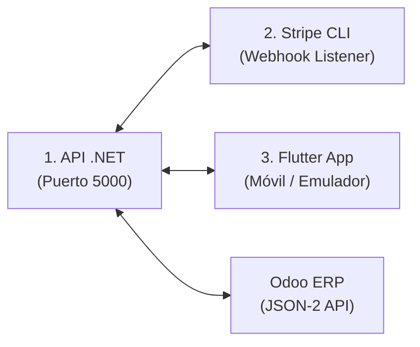

# E-commerce Móvil con Flutter, ASP.NET Core, Odoo y Stripe

Plataforma completa de comercio electrónico móvil que integra **Flutter** (Android/iOS) con una **Web API en ASP.NET Core (.NET 10)** bajo Clean Architecture, conectada a **Odoo Community (v17/v20)** como ERP para catálogo, clientes y pedidos de venta, y a **Stripe** para procesamiento seguro de pagos con tarjeta mediante PaymentIntents y webhooks criptográficamente firmados.

---

## 🚀 Inicio Rápido en Tres Pasos

Para levantar el ecosistema completo se requieren **3 terminales** abiertas en la raíz del proyecto. Asegúrate de tener Odoo levantado (local o en Docker) y tu archivo `.env` configurado.



### Paso 1: Iniciar la API REST (.NET 10)
En la **Terminal 1**, ejecuta el script de inicio:
```powershell
./scripts/run-api.ps1
```
*Compila el backend, verifica el puerto 5000, valida que `JWT_SECRET` tenga al menos 64 caracteres, carga las variables de entorno desde `.env` y expone los endpoints en `http://0.0.0.0:5000`.*

---

### Paso 2: Escuchar y reenviar Webhooks de Stripe
En la **Terminal 2**, ejecuta Stripe CLI para escuchar eventos de pago y reenviarlos a la API:
```powershell
stripe listen --events "payment_intent.succeeded,payment_intent.payment_failed,payment_intent.canceled" --forward-to http://100.75.46.80:5000/api/checkout/webhook
```
> [!IMPORTANT]
> Al iniciar, Stripe CLI mostrará en pantalla una clave secreta del webhook con formato:
> `Your webhook signing secret is whsec_xxxxxxxxxxxxxxxxxxxxxxxxxxxx`
> Si es la primera vez o la clave cambió, cópiala en tu archivo `.env` en la variable `STRIPE_WEBHOOK_SECRET=whsec_...` y reinicia la API (Paso 1).

---

### Paso 3: Ejecutar la Aplicación (Flutter)

#### Opción A: En Dispositivo Móvil / Emulador Android
En la **Terminal 3**, compila y lanza la app móvil:
```powershell
flutter run --dart-define=API_BASE_URL=http://100.75.46.80:5000 --dart-define=STRIPE_PUBLISHABLE_KEY=pk_test_51UeNlG41lvnNi0betl1jy8P8jB0BBcW7PsN0hbX3obPbmmzmkPekjCf5u3mA3UGX7fFd7kKf6gbVG6zrdlSPiWC700DRTDrSBp
```

#### Opción B: En Navegador Web (Chrome / Edge)
Si prefieres correrla directamente en la web en tu navegador:
```powershell
cd mobile
flutter run -d chrome --dart-define=API_BASE_URL=http://localhost:5000 --dart-define=STRIPE_PUBLISHABLE_KEY=pk_test_51UeNlG41lvnNi0betl1jy8P8jB0BBcW7PsN0hbX3obPbmmzmkPekjCf5u3mA3UGX7fFd7kKf6gbVG6zrdlSPiWC700DRTDrSBp
```
*(También puedes reemplazar `-d chrome` por `-d edge` si usas Microsoft Edge).*

---

## 🌐 Conectividad en Red y Tailscale (Cambio de Computadora)

Si estás trabajando en red local o a través de **Tailscale**:

1. **¿Qué es la IP `100.75.46.80`?**
   Es la dirección IP asignada a tu máquina dentro de tu red privada virtual de **Tailscale** (rango CGNAT `100.64.0.0/10`). Permite que tu teléfono móvil físico se conecte a la API de tu computadora sin importar si están en distintas redes Wi-Fi, siempre que el teléfono tenga la app de Tailscale encendida y conectada a la misma cuenta (Tailnet).

2. **¿Qué hacer si corres el proyecto en OTRA computadora?**
   - **Obtener la nueva IP de Tailscale:** En la nueva computadora, abre la terminal o la app de Tailscale y consulta tu IP (`tailscale ip -4` en consola). Supongamos que la nueva IP es `100.X.Y.Z`.
   - **Ajustar el comando de Stripe CLI (Paso 2):**
     - Si Stripe CLI corre en la **misma máquina** que la API: puedes usar `--forward-to http://localhost:5000/api/checkout/webhook` o `http://100.X.Y.Z:5000/api/checkout/webhook`.
   - **Ajustar el comando de Flutter (Paso 3):**
     - Cambia `--dart-define=API_BASE_URL=http://100.X.Y.Z:5000`.
   - **Actualizar `STRIPE_WEBHOOK_SECRET`:**
     - Al ejecutar `stripe listen` en una máquina o sesión nueva, Stripe CLI generará un nuevo secreto de webhook (`whsec_...`).
     - **Obligatorio:** Actualiza `STRIPE_WEBHOOK_SECRET` en tu `.env` y reinicia `./scripts/run-api.ps1`. Si no lo haces, los pagos pasarán en Stripe pero la API rechazará el webhook por firma inválida y la orden nunca se confirmará en Odoo.
   - **Emulador Android estándar:** Si no usas Tailscale y pruebas en el emulador de Android Studio en la misma PC, la IP del host es `http://10.0.2.2:5000`.

---

## 📦 Características y Funcionalidades del Sistema

### 🛍️ Catálogo y Productos
- Sincronización directa con Odoo: productos activos, descripción, precios e inventario en tiempo real.
- Filtrado por categorías jerárquicas dinámicas mediante chips interactivos.
- Buscador en tiempo real por nombre y descripción.
- Visualización de imágenes en alta definición con visor interactivo en pantalla completa (zoom y paneo).
- Control estricto de existencias: advertencia de stock insuficiente e imposibilidad de exceder el inventario disponible.

### 👤 Autenticación y Gestión de Perfil
- Registro de clientes con validación ecuatoriana (nombre, celular `09xxxxxxxx`, provincia de las 24 oficiales).
- Sincronización bidireccional inmediata con contactos (`res.partner`) de Odoo.
- Inicio de sesión con tokens JWT firmados con HMAC-SHA256 y hash de contraseñas con PBKDF2.
- Edición de perfil con persistencia de pedidos anteriores en snapshots locales.

### 🛒 Carrito Persistente y Multi-dispositivo
- Almacenamiento local para invitados y sincronización en servidor por cuenta (`account-carts.json`).
- Al iniciar sesión en cualquier dispositivo, el carrito del cliente se restaura automáticamente.

### 💳 Checkout y Pagos con Stripe
- Creación de cotización pendiente (`sale.order`) en Odoo con líneas y precios revalidados en backend.
- Soporte para cupones de descuento configurables (`DiscountCoupons` en `appsettings.json`).
- Integración nativa con Stripe PaymentIntents.
- Confirmación desacoplada y robusta mediante Webhook: la orden solo se confirma como venta (`sale`) en Odoo cuando Stripe certifica criptográficamente el evento `payment_intent.succeeded`.
- Resiliencia ante fallos: registro de intentos en `payment-attempts.json`.

### 📦 Gestión de Pedidos y Comprobantes
- Historial de pedidos confirmados por cliente autenticado.
- Detalle interactivo con trazabilidad de estado (`sale`, `done`, `cancel`).
- Confirmación de recepción: el cliente puede marcar su pedido como entregado/recibido.
- Generación de comprobante PDF profesional directamente en la app con desglose de productos, totales y datos del cliente.
- Historial completo de transacciones y estados de pago en Stripe (`/api/payments/history`).

### 📍 Direcciones de Envío Guardadas
- Múltiples direcciones por cliente con etiqueta (Casa, Trabajo, etc.), destinatario, calle, ciudad, provincia, código postal (6 dígitos) y teléfono celular (`09xxxxxxxx`).
- Selección de dirección principal (sincronizada automáticamente con Odoo).
- Protección de integridad: la dirección predeterminada no se puede eliminar, solo editar.
- Confirmación modal segura (`barrierDismissible: false`) para evitar cierres accidentales.
- Detección de cambios sin guardar con diálogo de confirmación antes de salir.

### ⭐ Reseñas y Calificaciones
- Calificación de 1 a 5 estrellas y comentarios de hasta 1000 caracteres.
- **Regla de negocio estricta:** Solo se permite calificar productos que el cliente haya comprado efectivamente en pedidos confirmados (`sale` o `done`).
- Edición y eliminación de reseñas propias con actualización reactiva instantánea.
- Promedio y conteo de reseñas visible en el detalle del producto para todos los usuarios.

### 💖 Favoritos y Notificaciones
- Guardado y eliminación de productos favoritos con actualización optimista inmediata.
- Notificaciones automáticas ante cambios de estado en pedidos de Odoo.
- Marcado de notificaciones leídas.

---

## 🛠️ Estructura del Proyecto

```text
Ecommerce/
├── backend/                         # Backend en ASP.NET Core (.NET 10)
│   ├── ECommerce.Domain/            # Entidades de negocio puras
│   ├── ECommerce.Application/       # Casos de uso, validaciones y contratos
│   ├── ECommerce.Infrastructure/    # Adaptadores Odoo JSON-2, Stripe, JWT y JSON stores
│   └── ECommerce.WebApi/            # Controladores REST, middleware y configuración
├── mobile/                          # Cliente móvil en Flutter
│   ├── lib/
│   │   ├── domain/                  # Modelos de negocio inmutables
│   │   ├── application/             # Casos de uso e interfaces de repositorios
│   │   ├── infrastructure/          # Clientes HTTP, persistencia y Stripe Native
│   │   └── presentation/            # Pantallas Flutter (Catálogo, Checkout, Perfil, etc.)
├── deployment/                      # Docker Compose para Odoo Community y PostgreSQL
├── docs/                            # Documentación técnica
│   ├── api.md                       # Especificación completa de endpoints HTTP
│   ├── arquitectura.md              # Diagramas y decisiones de diseño
│   ├── plan-trabajo.md              # Estado de módulos y requerimientos
│   └── pruebas.md                   # Matriz de pruebas y criterios de aceptación
└── scripts/                         # Scripts de ejecución automatizada
    ├── run-api.ps1                  # Compila y arranca la Web API
    └── run-mobile.ps1               # Lanza la aplicación Flutter
```

---

## ⚙️ Configuración del Archivo `.env`

Copia `.env.example` a `.env` en la raíz del proyecto y completa tus credenciales:

```env
# Conexión con Odoo Community
ODOO_BASE_URL=http://localhost:8069
ODOO_DB=ecommerce_limpio
ODOO_API_KEY=tu_api_key_de_usuario_tecnico

# Seguridad de Tokens
JWT_SECRET=tu_clave_aleatoria_muy_larga_de_al_menos_64_caracteres_hex_o_alfanumericos

# Pasarela de Pagos Stripe
STRIPE_SECRET_KEY=sk_test_...
STRIPE_WEBHOOK_SECRET=whsec_...
STRIPE_PUBLISHABLE_KEY=pk_test_...
STRIPE_CURRENCY=usd
```

---

## 📖 Documentación Adicional

- [Contrato HTTP de la API REST (api.md)](docs/api.md)
- [Arquitectura de la Solución (arquitectura.md)](docs/arquitectura.md)
- [Guía de Pruebas y Aceptación (pruebas.md)](docs/pruebas.md)
- [Plan de Trabajo y Estado (plan-trabajo.md)](docs/plan-trabajo.md)
- **Swagger / OpenAPI interactivo:** disponible en `http://localhost:5000/swagger` cuando la API está corriendo.
