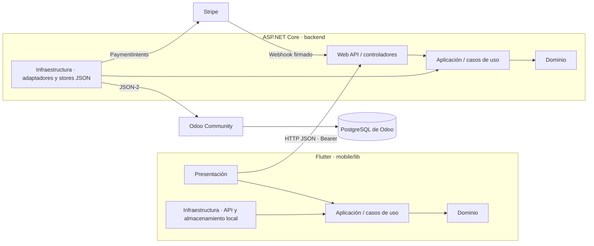
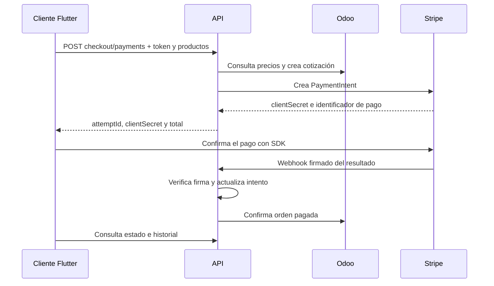

# Arquitectura de la solución

La solución integra una aplicación Flutter, una API ASP.NET Core y Odoo Community. Flutter solo consume la API propia. La API consulta el catálogo y administra los contactos y pedidos en Odoo; Stripe procesa los pagos y notifica el resultado al backend mediante webhooks.

## Aplicación móvil

- `mobile/lib/presentation`: navegación y pantallas de catálogo, detalle, cuenta, carrito, checkout, pedidos, direcciones y funciones de cliente.
- `mobile/lib/application`: casos de uso y contratos para autenticación, catálogo, pedidos, checkout y funciones del cliente.
- `mobile/lib/domain`: entidades y reglas independientes de Flutter y HTTP.
- `mobile/lib/infrastructure`: repositorios API, carrito local, configuración de Stripe y adaptadores nativos/web.

La app usa `API_BASE_URL` y `STRIPE_PUBLISHABLE_KEY` como `--dart-define`. La clave publicable puede estar en el cliente; las claves secretas de Stripe/Odoo y el secreto JWT son exclusivos del backend.

## API y backend

La solución .NET separa `ECommerce.WebApi`, `ECommerce.Application`, `ECommerce.Domain` y `ECommerce.Infrastructure`. Los controladores REST exponen catálogo, autenticación, carrito, checkout, pedidos, historial de pagos y funciones de cuenta. Application concentra los casos de uso y sus interfaces; Infrastructure implementa los adaptadores de Odoo JSON-2, Stripe y persistencia local.

La autenticación protege las operaciones de cuenta con Bearer token y el `partner_id` identifica al cliente. El backend vuelve a validar líneas y precios al iniciar checkout. Crea una cotización en Odoo, inicia el PaymentIntent y confirma idempotentemente el pedido tras recibir el evento firmado de Stripe. Los fallos y cancelaciones quedan registrados como estados del intento.

Los cupones se definen en `DiscountCoupons` de `backend/ECommerce.WebApi/appsettings.json` o en configuración del servidor. Cada regla contiene `Code`, `Percentage` y `ProductIds`; el backend aplica el descuento a los productos configurados después de consultar precios actuales.

## Persistencia y servicios externos

- Odoo administra catálogo, contactos y cotizaciones/órdenes; PostgreSQL es su base de datos.
- El backend guarda datos auxiliares en archivos JSON locales: cuentas, carritos, funciones de cliente, intentos de pago y snapshots de órdenes. Deben conservarse entre reinicios para mantener continuidad. Este almacenamiento local requiere una alternativa compartida y durable para despliegues con varias instancias.
- Stripe se integra desde el servidor con `STRIPE_SECRET_KEY`. El cliente usa la clave publicable. Stripe CLI reenvía eventos al endpoint local durante desarrollo; `STRIPE_WEBHOOK_SECRET` valida la firma.

## Configuración y ejecución

El script `scripts/run-api.ps1` carga `.env`, valida `JWT_SECRET` (mínimo 64 caracteres), prepara configuración de Odoo/Stripe, compila y sirve la API en `0.0.0.0:5000`. `scripts/run-mobile.ps1` carga `STRIPE_PUBLISHABLE_KEY` desde `.env` y puede resolver la IP de Tailscale o aceptar `-ApiBaseUrl`. El flujo manual de tres terminales está documentado en el [README](../README.md).

La documentación interactiva de la API se sirve en `/doc` y `/swagger`.

## Responsabilidades y límites de confianza

Flutter presenta el flujo de compra y mantiene configuración pública necesaria para inicializar Stripe. No debe conocer la API key de Odoo, la clave secreta de Stripe ni el secreto de firma de webhooks. El backend es el punto de control para autenticación, validación de datos, precios, descuentos, creación de pedidos y confirmación de pagos.

Odoo es la referencia para productos, precios del catálogo, contactos y órdenes de venta. Los importes enviados por Flutter o almacenados en el carrito no autorizan el cobro: el caso de uso de checkout vuelve a obtener y validar la información requerida antes de crear el intento de pago. La API devuelve al móvil el `clientSecret` necesario para completar la acción de pago de ese intento.

Stripe y la API tienen responsabilidades separadas: el cliente inicia la experiencia de pago mediante el SDK; el backend crea el PaymentIntent usando su clave secreta; Stripe notifica resultados al endpoint webhook. El webhook valida `Stripe-Signature` con el secreto vigente y procesa eventos de forma idempotente antes de confirmar la cotización en Odoo. El cliente no debe decidir por sí mismo que una orden está pagada.

## Secuencia de compra

Un intento puede permanecer pendiente mientras se procesa el webhook. Un fallo o cancelación se refleja en el estado del pago; no debe mostrarse como compra confirmada en el historial de pedidos.

## Componentes y dependencias

En Flutter, `presentation` depende de contratos/casos de uso de `application`; las implementaciones concretas viven en `infrastructure`. El dominio mantiene los modelos y reglas que no dependen de la interfaz. Los repositorios de API encapsulan HTTP y conversión JSON para que las pantallas no construyan solicitudes directamente.

En backend, `WebApi` traduce HTTP a comandos/consultas de Application. `Application` coordina reglas y depende de interfaces; `Infrastructure` implementa esas interfaces contra Odoo, Stripe y archivos JSON. `Domain` contiene los modelos del negocio. Este diseño permite que los controladores no expongan protocolos de Odoo o Stripe al cliente móvil.

## Persistencia local y continuidad

Los JSON stores hacen que datos auxiliares sobrevivan al ciclo normal de la aplicación cuando los archivos se mantienen en el mismo despliegue. Deben respaldarse junto con el entorno local si tienen datos que se desean conservar. No son una base transaccional compartida: dos procesos o instancias podrían no ver la misma información. Para escalar o desplegar, se requiere almacenamiento durable con coordinación y copias de seguridad adecuadas.

Los snapshots de pedido complementan la consulta a Odoo para conservar información que la experiencia de cliente necesita, por ejemplo después de cambios de perfil. No sustituyen a Odoo como sistema de ventas.

## Red de desarrollo

El script de API publica el servidor en `0.0.0.0:5000` para aceptar conexiones de la red de desarrollo. Eso no hace que cualquier URL sea automáticamente accesible: el host, firewall, red del dispositivo y `API_BASE_URL` deben coincidir. Stripe CLI debe poder abrir una conexión local a la URL de reenvío. En producción se requiere una URL pública HTTPS para webhooks y una configuración de red segura.
