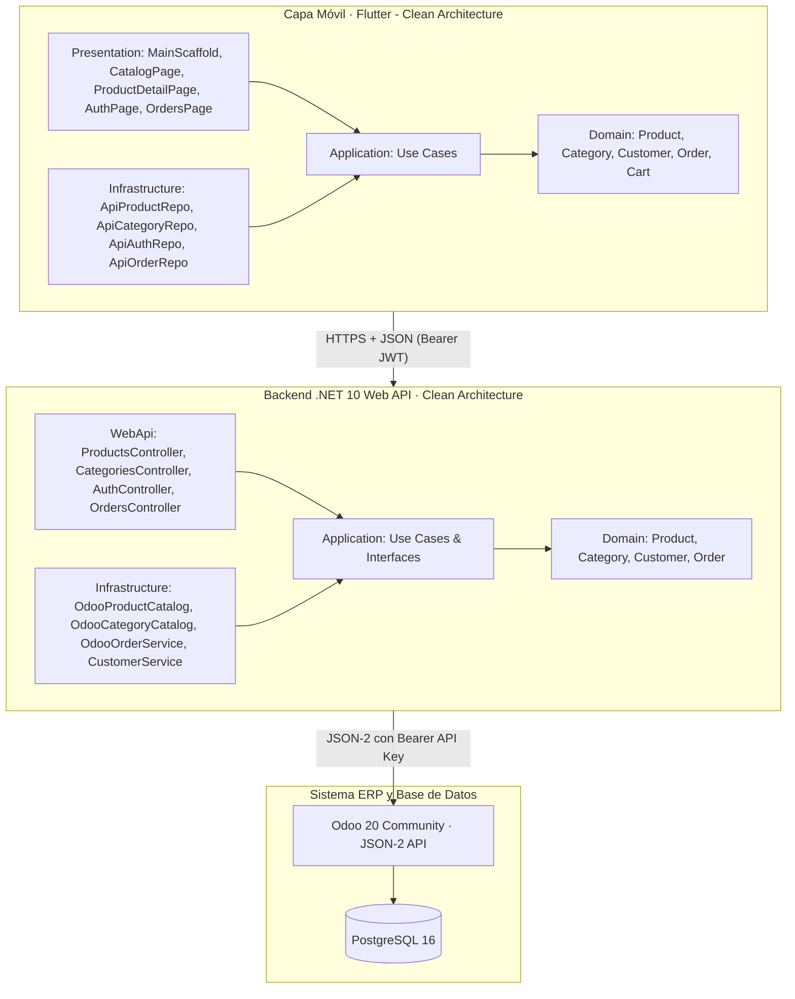

# Arquitectura de la Solución E-Commerce Integrada con Odoo 20

## Separación de Responsabilidades

### 1. Aplicación Móvil (Flutter)
- **Domain (`mobile/lib/domain`):** Entidades puras e inmutables del negocio móvil (`Product`, `Category`, `Customer`, `OrderModel`, `Cart`, `CartItem`). Lógica de carrito con rechazo de cantidades `<= 0` y cálculo de subtotal. Independiente de frameworks visuales o HTTP.
- **Application (`mobile/lib/application`):** Casos de uso (`GetProducts`, `GetProductDetail`, `GetCategories`, `RegisterCustomer`, `LoginCustomer`, `CreateOrder`, `GetCustomerOrders`, `GetOrderDetail`, `CartUseCases`) y contratos/interfaces de repositorios.
- **Infrastructure (`mobile/lib/infrastructure`):** Implementaciones que se comunican exclusivamente con la Web API en ASP.NET Core (`ApiProductRepository`, `ApiCategoryRepository`, `ApiAuthRepository`, `ApiOrderRepository`, `InMemoryCartRepository`).
- **Presentation (`mobile/lib/presentation`):** Pantallas interactivas y componentes (`MainScaffold`, `CatalogPage` con filtros de categoría por chips, `ProductDetailPage`, `AuthPage`, `OrdersPage`, `OrderDetailPage`).

### 2. Backend Intermedio (ASP.NET Core .NET 10)
- **Domain (`ECommerce.Domain`):** Modelos de negocio sin dependencias técnicas (`Product`, `Category`, `Customer`, `Order`, `OrderItem`).
- **Application (`ECommerce.Application`):** Casos de uso con reglas de negocio obligatorias (validación de líneas de pedido, precios de Odoo, autorización por cliente) e interfaces (`IProductCatalog`, `ICategoryCatalog`, `ICustomerService`, `IOrderService`).
- **Infrastructure (`ECommerce.Infrastructure`):** Adaptador oficial JSON-2 hacia Odoo (`/json/2/product.product/search_read`, `/json/2/product.category/search_read`, `/json/2/sale.order/create`, `/json/2/sale.order/action_confirm`, `/json/2/sale.order/search_read`), sincronización de contactos (`res.partner`), hash seguro con PBKDF2 y tokens Bearer JWT firmados con HMAC-SHA256.
- **WebApi (`ECommerce.WebApi`):** Controladores REST (`ProductsController`, `CategoriesController`, `AuthController`, `OrdersController`), autenticación por claims (`partner_id`), manejo de errores estándar (`ProblemDetails`) y documentación interactiva en `/doc` o `/swagger`.

### 3. ERP (Odoo 20 Community + PostgreSQL 16)
- Gestionado vía Docker Compose. Administra productos, inventario, precios y cotizaciones/órdenes de venta.
