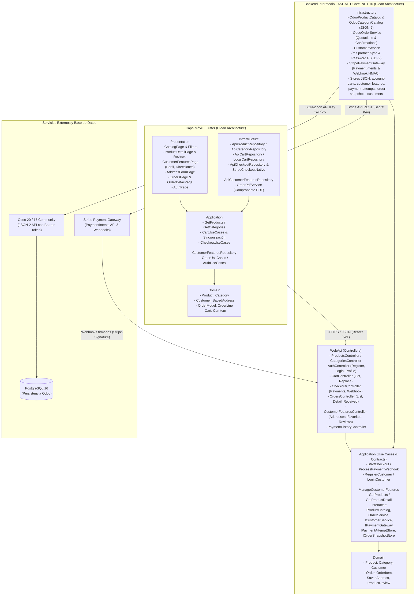
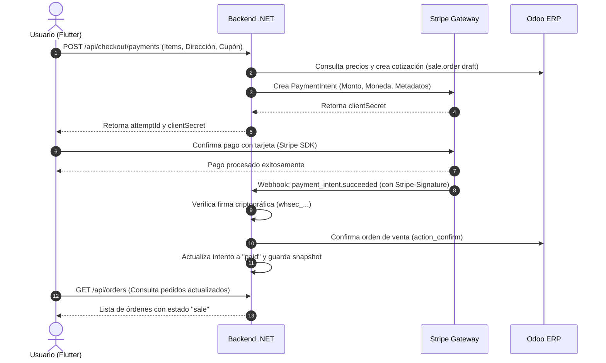

# Arquitectura de la Solución E-Commerce Integrada con Odoo y Stripe

La solución implementa una arquitectura desacoplada basada en los principios de **Clean Architecture** (Arquitectura Limpia) tanto en el cliente móvil (**Flutter**) como en el backend intermedio (**ASP.NET Core .NET 10**), conectándose a **Odoo Community** mediante su protocolo oficial JSON-2 y a **Stripe** para la pasarela de pagos.

---

## Diagrama General de la Arquitectura

---

## Separación de Responsabilidades

### 1. Cliente Móvil (Flutter)
- **Domain (`mobile/lib/domain`):** Modelos de negocio puros, inmutables y desacoplados del framework visual o HTTP (`Product`, `Category`, `Customer`, `OrderModel`, `Cart`, `CartItem`, `CheckoutPayment`). Maneja reglas locales de validación de cantidades mayores a cero y subtotales.
- **Application (`mobile/lib/application`):** Interfaces abstractas de repositorios (`ProductRepository`, `CustomerFeaturesRepository`, `CartRepository`, etc.) y casos de uso organizados por módulo (`GetProducts`, `AuthUseCases`, `CartUseCases`, `OrderUseCases`).
- **Infrastructure (`mobile/lib/infrastructure`):** Conectores HTTP hacia la API REST (`ApiCustomerFeaturesRepository`, `ApiCheckoutRepository`, etc.), pasarela nativa de Stripe (`StripeCheckoutNative` mediante `flutter_stripe`), serialización JSON y generación de comprobantes PDF en memoria (`OrderPdfService`).
- **Presentation (`mobile/lib/presentation`):** Pantallas reactivas construidas con Material 3:
  - `CatalogPage`: Catálogo interactivo con filtrado por categorías mediante chips horizontales y buscador.
  - `ProductDetailPage`: Ficha técnica, selector de cantidad con límite de existencias, visor de imágenes zoomable, reseñas de clientes y botón de favoritos.
  - `CustomerFeaturesPage`: Perfil del cliente, lista de favoritos, direcciones guardadas, avisos de pedidos y reseñas del usuario.
  - `AddressFormPage`: Formulario con validación estricta de provincias ecuatorianas, ciudades dependientes, teléfono celular de 10 dígitos y código postal de 6 dígitos.
  - `OrdersPage` y `OrderDetailPage`: Trazabilidad de pedidos, botón para marcar recibido y exportación de comprobante PDF.
  - `AuthPage`: Pestañas de inicio de sesión y registro con validaciones en tiempo real.

---

### 2. Backend Intermedio (ASP.NET Core .NET 10)
- **Domain (`ECommerce.Domain`):** Entidades de dominio libres de dependencias tecnológicas externas.
- **Application (`ECommerce.Application`):** Casos de uso con orquestación del flujo de compras, validación de cupones de descuento, verificación de compras previas antes de permitir reseñas y contratos de abstracción.
- **Infrastructure (`ECommerce.Infrastructure`):**
  - **Adaptadores Odoo JSON-2:** Conexión HTTP al endpoint `/jsonrpc` o rutas JSON-2 de Odoo para consultar `product.template`, `product.category`, `res.partner` y `sale.order`.
  - **Adaptador Stripe:** Creación de `PaymentIntent` y validación criptográfica de firmas de webhook (`Stripe-Signature`) mediante HMAC-SHA256 con `STRIPE_WEBHOOK_SECRET`.
  - **Seguridad:** Hashing seguro de contraseñas con PBKDF2 y generación de tokens JWT firmados con claim `partner_id`.
  - **Stores de Persistencia Local (JSON):**
    - `customers.json`: Credenciales de clientes locales vinculadas al `partner_id` de Odoo.
    - `account-carts.json`: Carrito de compras persistente por ID de cuenta.
    - `customer-features.json`: Direcciones de envío, productos favoritos, notificaciones y reseñas.
    - `payment-attempts.json`: Auditoría y estados de cada intento de pago iniciado en Stripe.
    - `order-snapshots.json`: Copia histórica inmutable de pedidos para emisión de comprobantes y validación de reseñas incluso si el cliente actualiza su nombre en Odoo.
- **WebApi (`ECommerce.WebApi`):** Controladores REST que aplican políticas de autorización Bearer JWT, captura de errores estándar (`ProblemDetails`), compresión y documentación interactiva Swagger.

---

### 3. ERP (Odoo Community + PostgreSQL)
- **Catálogo maestro:** Define los productos, precios oficiales, impuestos y existencias en almacén.
- **Contactos (`res.partner`):** Almacena los clientes registrados y su dirección principal de entrega.
- **Ventas (`sale.order`):** Registra las cotizaciones iniciales en estado borrador (`draft`) y las confirma como órdenes de venta oficiales (`sale`) cuando la pasarela de pagos notifica el cobro exitoso.

---

## Flujos Clave de Integración

### 1. Flujo de Compra y Confirmación con Stripe

### 2. Flujo de Direcciones y Sincronización con Odoo
- Cuando el cliente registra su primera dirección o marca una dirección como predeterminada (`isDefault: true`), el backend invoca a Odoo para actualizar los campos `street`, `city`, `state_id`, `zip` y `phone` en el registro `res.partner`.
- La dirección principal está protegida y no se puede eliminar sin antes asignar otra dirección como predeterminada.
- Las ventanas de confirmación modales de eliminación y descarte tienen `barrierDismissible: false` para evitar cierres involuntarios al tocar fuera del diálogo.

### 3. Flujo de Reseñas Verificadas
- Un cliente solo puede emitir una calificación de 1 a 5 estrellas si el producto pertenece a una orden suya confirmada (`sale` o `done`).
- El backend comprueba primero los snapshots locales y, de ser necesario, consulta a Odoo para verificar la compra antes de registrar la reseña en `customer-features.json`.
- La lista pública de reseñas agrupa las calificaciones por cliente, mostrando la más reciente en la ficha del producto.
